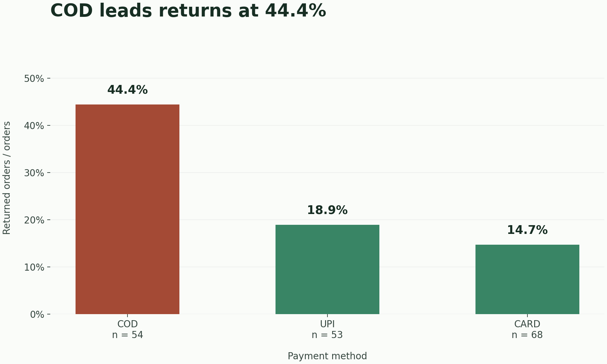
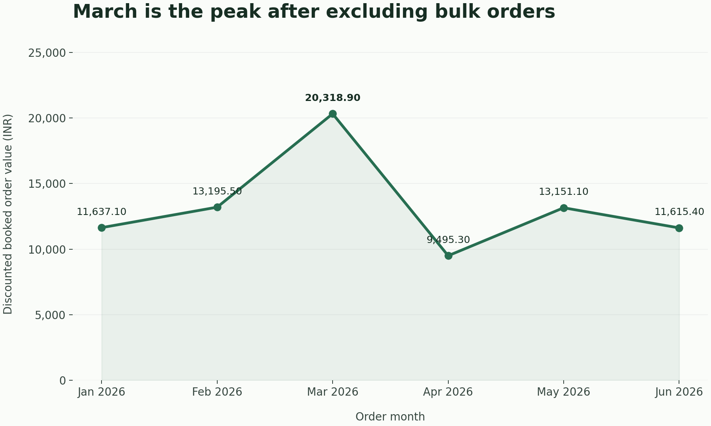

# Mamaearth Returns & Growth Intelligence Pipeline

A reproducible capstone for **Data Analytics with AI & Gen AI · E&ICT Academy IIT Roorkee**. SQLite reports audit the supplied raw orders, pandas removes duplicate submissions and investigates returns, and a findings-driven narrator produces a Situation–Complication–Resolution report for regional ops and finance.

**Submission:** this public GitHub repository. All source data, SQL, Python, generated charts, verified findings and an actual offline narrative sample are committed here.

## Run from top to bottom

Use **Python 3.12** and run the following commands from the repository root. The pinned pandas version is not intended for Python 3.14. SQLite is included in Python, so a separate SQLite executable is optional.

```bash
python3.12 -m venv .venv
source .venv/bin/activate
python -m pip install -r requirements.txt
```

On Windows, activate with `.venv\Scripts\activate` and use `py -3.12 -m venv .venv`. Package installation needs network access unless packages are already installed or available in a local wheel cache; after installation the complete default pipeline needs neither network access nor API credentials.

### 1. Load the raw SQL layer and run every report

```bash
python sql/run_sql.py
```

This executes **`sql/schema.sql` → `sql/seed_data.sql` → `sql/reports.sql`**, prints all report results and writes `sql/generated/mamaearth.db` and `sql/generated/reports.json`. The schema recreates only the three capstone tables. Every full run starts fresh, including the loyalty column added by the final report. Do not point the runner at a database containing valuable tables with these names.

The committed seed uses `INSERT` statements generated directly from the CSVs. Empty discount/rating cells are SQL `NULL`, while payment casing and duplicate submissions remain untouched. To regenerate the seed without editing the data:

```bash
python sql/build_seed.py
python sql/run_sql.py
```

Equivalent optional SQLite CLI commands:

```bash
mkdir -p sql/generated
sqlite3 sql/generated/mamaearth.db < sql/schema.sql
sqlite3 sql/generated/mamaearth.db < sql/seed_data.sql
sqlite3 -header -column sql/generated/mamaearth.db < sql/reports.sql
```

Re-run all three files in that order; running only `reports.sql` again will encounter the already-added loyalty column. Exact executed outputs appear as comments above each query in `sql/reports.sql`. Raw row counts are customers **45**, products **16**, orders **180**; raw revenue is **₹99,860.20** and average order value is **₹554.78**.

### 2. Run the independent pandas analysis and create the charts

```bash
python analysis/clean_and_eda.py
python analysis/visualize.py
```

`clean_and_eda.py` reads **the three original CSVs directly**, prints every required intermediate result and asserts the brief's acceptance values. Part 2 Task 5 computes the revenue reconciliation; the export at the end of this same script writes **`narrator/findings.json`**, once segmentation and monthly analysis are also complete. This file is never hand-entered. It also writes the cleaned orders and payment/monthly summary tables to `analysis/generated/`.

`visualize.py` consumes those generated summary tables. It checks their recorded source hashes against the current raw CSVs and asks for analysis to be rerun if the sources have changed. It saves the required charts:





The introductory brief describes a linear SQL-to-pandas feed, but its detailed Part 2 instructions explicitly require independent CSV loading and either execution order. This repository follows those detailed instructions: SQL and pandas share immutable inputs; the test suite reconciles the raw SQL result against pandas. The actual downstream data flow is:

```text
data/*.csv ──> sql/seed_data.sql ──> SQLite ──> raw SQL reports
     │                                           │
     └──────> pandas cleaning + EDA <── test reconciliation
                    ├──> analysis/generated/ ──> Matplotlib PNGs
                    └──> narrator/findings.json ──> SCR narrator
```

### 3. Produce and check the business narrative

With no key configured, the ordinary command uses the offline path automatically:

```bash
python narrator/generate_narrative.py
```

To guarantee offline execution even if a key exists in your environment:

```bash
python narrator/generate_narrative.py --offline
python narrator/generate_narrative.py --check-sample
```

The offline narrator uses only Python's standard library. It formats findings directly into the three SCR sections, checks all required figures, and saves `narrator/sample_output.txt` plus `narrator/sample_metadata.json`. The committed sample is an actual **offline** run, with zero API tokens. A live Gemini call was not performed for this submission because no Gemini key was configured; the sample is not represented as Gemini output.

**Free-path statement:** Google AI Studio issues a free Gemini API key with a free usage tier. Use that free tier, never a paid-only key. The fully offline, keyless fallback makes this pipeline gradable with zero API spend or network access. See Google's [API key instructions](https://ai.google.dev/gemini-api/docs/api-key) and [model pricing/free-tier availability](https://ai.google.dev/gemini-api/docs/pricing). A key alone does not enforce a spending limit; use a free-tier project without paid billing for this capstone.

Optional Gemini path, using a key obtained in AI Studio:

```bash
python -m pip install -r requirements-gemini.txt
export GEMINI_API_KEY="your-free-tier-key"
export GEMINI_MODEL="gemini-2.5-flash"
python narrator/generate_narrative.py
python narrator/generate_narrative.py --check-sample
```

`GOOGLE_API_KEY` is also accepted; `GEMINI_API_KEY` takes precedence. Do not put a real key in a tracked file. After a successful live run, the saved sample and metadata record the actual online output; commit both if submitting the online path. A failed request or invalid response transparently uses the offline template and records that fallback in metadata.

The Gemini integration uses `from google import genai`, a separate system instruction, a JSON user prompt built from the supplied findings, temperature `0.0`, an explicit output limit of `2048` tokens and a `30000` ms request timeout. Thinking is disabled for the default Flash model so the output budget is available for prose. Temperature zero reduces sampling variation; it cannot guarantee identical live text. Configuration follows the [official Python SDK](https://googleapis.github.io/python-genai/).

`request_gemini()` returns the required success/error dictionary without leaking exceptions. `generate_scr_narrative()` wraps that API contract with fallback; `generate_scr_narrative_offline()` returns the same success shape. Both include mode provenance. Five required numerical checks print a PASS/FAIL line each, normalizing comma separators and trailing decimal zeroes. An extra guard rejects numeric literals absent from findings and checks SCR headings. These are mechanical checks, not proof that generated prose interprets every number correctly; review the saved online narrative when using it.

## Verified findings and interpretation

| Measure | Computed result |
|---|---:|
| Raw / deduplicated orders | 180 / 175 |
| Raw / cleaned booked revenue | ₹99,860.20 / ₹97,358.30 |
| Duplicate-only reconciliation delta | ₹2,501.90 |
| CARD returns | 14.7% of 68 orders |
| COD returns | 44.4% of 54 orders |
| UPI returns | 18.9% of 53 orders |
| COD in Tier-1 / Tier-2 cities | 37.5% of 32 / 54.5% of 22 |
| January including / excluding bulk orders | ₹29,582.10 / ₹11,637.10 |
| Peak after excluding bulk orders | March 2026 · ₹20,318.90 |

The five duplicates are O0176–O0180. Missing discounts are filled with zero, matching SQL `COALESCE`; missing ratings are filled with the deduplicated median. Neither changes the revenue reconciliation. The quantity IQR rule flags O0011 and O0098 but retains them in the cleaned dataset. Only the alternate monthly view excludes them. All six pairwise correlations are negligible; the discount/return coefficient is approximately −0.088, so the proposed discount hypothesis is labeled Busted as evidence in this sample, without making a causal claim.

Revenue is `quantity × price × (1 − discount_pct / 100)` **including returned orders**. It is discounted booked order value, not cash retained, refund-adjusted revenue or profit. Costs, refund amounts and shipping data are absent, so actual margin loss cannot be quantified. “Confirmed” for COD means its observed return rate is higher in this dataset; no significance test or causal identification is claimed. The analysis also flags orders predating recorded customer signup dates, retains them as supplied and avoids acquisition-cohort conclusions. This is synthetic educational data, not a statement about Mamaearth's actual business performance.

## Repository map

```text
.
├── README.md
├── requirements.txt                 # Pinned pandas, NumPy, Matplotlib
├── requirements-gemini.txt          # Optional pinned Google SDK
├── sql/
│   ├── schema.sql
│   ├── seed_data.sql
│   ├── reports.sql                  # Queries and actual output comments
│   ├── build_seed.py
│   └── run_sql.py
├── data/
│   ├── customers.csv
│   ├── products.csv
│   ├── orders.csv
│   └── source_manifest.json         # Source hashes and row counts
├── analysis/
│   ├── clean_and_eda.py
│   └── visualize.py
├── visualizations/
│   ├── return_rate_by_payment.png
│   └── monthly_revenue_trend.png
├── narrator/
│   ├── findings.json
│   ├── generate_narrative.py
│   ├── sample_output.txt
│   └── sample_metadata.json
├── tests/test_pipeline.py
└── .github/workflows/validate.yml
```

`sql/generated/`, `analysis/generated/`, virtual environments and plot caches are reproducible runtime files and are ignored by Git. The required charts, findings and narrative sample are committed. The source manifest checks the original CSV bytes, including the deliberate blanks and casing.

## Validate

After running the pipeline:

```bash
python -m unittest discover -s tests -v
```

Tests cover exact SQL outputs and their comments, SQL NULL/FK behavior, regenerated seed equality, source hashes, deduplication and reconciliation, segment denominators, findings reproducibility, deterministic keyless narration, API-error fallback, altered-input propagation, and missing/unsupported figures. Optional SDK contract tests use a mock client to check system instructions, request parameters, token reporting and error handling; they never call the network. Install `requirements-gemini.txt` to include those tests, otherwise they skip explicitly. GitHub Actions runs the entire offline pipeline on Python 3.12, runs all tests with the SDK installed and checks generated committed artifacts for drift.

The scripts resolve paths relative to their files, not the current working directory. With the same pinned environment and source data, repeated offline runs regenerate identical findings, narrative text and PNGs. Font rendering can vary across operating systems; numerical chart data remains the same.
